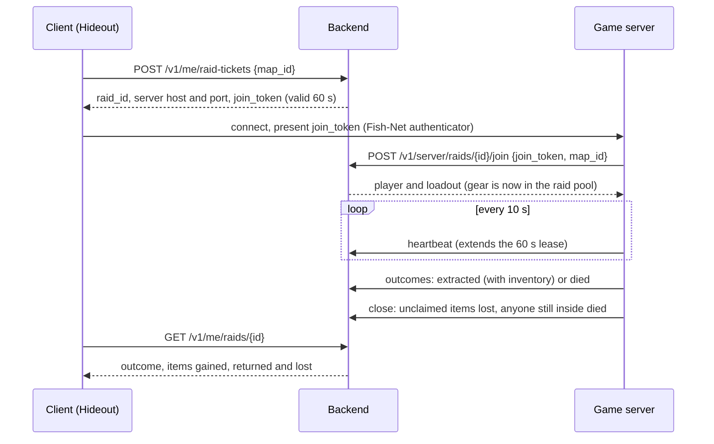

# Raid Zero: Backend API & Data Model

Will & John · first written Oct 26, 2026 · last updated Oct 28, 2026

## Status

| Area | State |
| --- | --- |
| Data model, migrations 0001 to 0005 | Done |
| Client API (dev login, profile, stash edits, tickets, raid results) | Done |
| Game server API (join, heartbeat, outcomes, close) and lease expiry | Done |
| Admin API and page | Done |
| Integrity rules | Done, each with tests |
| Steam login, matchmaker, traders, insurance | Not started |

Everything in Milestone 1's scope is built and tested. This doc is the design: what each piece does and why. For
how to run, configure and deploy it, see the README and `deploy/README.md`.

## Overview

The backend owns everything that persists between raids; the game server owns everything inside a raid; the
client owns nothing. A raid takes up to four players (`MaxPlayersPerRaid`), and every table and endpoint below
already supports squads, so co-op and PvPvE need no schema rewrite.

**Scope for Milestone 1:** dev login, stash and equipment management, raid tickets, loadout checkout,
extraction and death reports, raid close, and admin tooling. Out of scope: real accounts, matchmaking, traders,
crafting, insurance, wipes.

**Stack:** ASP.NET Core on .NET 10, SQLite through Dapper, and a shared C# library (`shared/Game.Shared`) that
holds the inventory rules the backend, the game server and the client all run.

**Design principles**

- **Every item is an instance with a UUID.** Weapons, armor, ammo stacks and currency all live in one
  `item_instances` table. One code path handles loot, extraction and loss.
- **Every instance is in exactly one place.** In a stash, in a raid, or gone (lost, consumed, discarded,
  merged, sold). No operation can make an item exist in two places.
- **Items in a raid belong to the raid, not a player.** Checkout moves gear into the raid's pool; extraction
  claims items out of it; whatever is unclaimed when the raid closes is lost. This is what makes picking up
  another player's gear work.
- **Raid results are transactions.** Each report from the game server is idempotent and either commits fully
  or not at all.
- **Optimistic concurrency on profiles.** Stash edits carry the profile version they were based on; stale edits
  are rejected, never merged.
- **Start on SQLite, stay Postgres-compatible.** Plain SQL types, no SQLite-only features, so moving to
  Postgres is a config change.

## Raid lifecycle

Gear moves into the raid pool only at join, after the player has actually connected, and only outcomes and
close decide what comes out.



- **Tickets** last `TicketSeconds` (60). One that is never redeemed expires (participant state `expired`)
  without touching items.
- **Grouping:** a ticket joins a raid on the same map that started less than `JoinWindowSeconds` (120) ago
  and has room; otherwise it opens a new one. Late players start the next raid instead of dropping into one
  that's nearly over.
- **Leases:** the game server heartbeats every 10 seconds; the lease is `LeaseSeconds` (60). A background job
  (every `ReaperIntervalSeconds`, 10) aborts raids whose lease ran out and refunds everyone still inside (see
  Close and lease expiry).
- **One raid per server process.** The game server exits after its raid closes and a fresh one starts for the
  next, so nothing leaks between raids.

## Data model

Six tables carry Milestone 1; item definitions live in a JSON catalog exported from Unity, not in the
database.

| Table | Holds | Notes |
| --- | --- | --- |
| `players` | One row per account | Points at two root containers: stash and character |
| `item_instances` | Every item that exists or existed | Items nest via `parent_id` (backpack → contents, rifle → magazine → ammo) |
| `raids` | One row per raid session | Has a lease the game server must keep renewing |
| `raid_participants` | One row per player per raid | Stores the loadout snapshot taken at checkout |
| `ledger_entries` | Append-only audit of every item change | Your best friend when chasing a dupe bug |
| `idempotency_keys` | Responses to already-processed server reports | Lets the game server retry safely |

### Item catalog (not a table)

Item definitions are `ItemDefinitionAsset` ScriptableObjects in Unity (`unity/RaidZero/Assets/_Project/Data/Items`).
Saving one exports all of them to `shared/catalog/item_catalog.json`, which is committed; the backend and game
servers load it at startup. Each definition has:

- a stable string `def_id` (`rifle_ak_basic`, `ammo_545_ps`, `currency_credits`), never changed once an item
  has been in anyone's stash;
- a footprint (`width`, `height`), `max_stack`, `has_durability`, and `tags` (`weapon_long`, `ammo_545`);
- named `slots`, each accepting items by tag and optionally capping a quantity (a magazine's `rounds` slot takes
  30 rounds of `ammo_545`);
- zero or more named `grids`: one called `grid` for a backpack, crate or the stash, or one per pocket for a rig.

The catalog carries a `catalog_version`, a hash of its contents (grids included, in order). The game server
sends its version on every call and the backend refuses a mismatch (`catalog_mismatch`), so a stale build can't
commit items it doesn't understand. CI checks that the committed version matches the file's contents.

### Item location model

Every player has two root container instances, created at signup: a **stash** (a 10×30 grid) and a
**character** (named equipment slots: `primary`, `secondary`, `armor`, `rig`, `backpack`). An item's position
is `parent_id` + `slot` + optional grid `x`, `y`, `rotated`. In a grid, `slot` is the grid's name (`grid`, or a
pocket's name), so an item can't straddle two pockets. Equipping is just moving an item under the character
root. Checkout takes the character root's whole subtree into the raid.

A move to `"slot": "grid"` with no `x` and `y` means the first free spot in any of the container's grids, in
the order the item lists them.

Currency is a stackable item (`currency_credits`). That keeps money lootable and losable through the same path
as everything else; revisit if traders make a separate balance column simpler.

### Schema

As of migration 0005. The migrations in `backend/Game.Backend/Migrations` are the source of truth; this is the
shape they add up to.

```sql
CREATE TABLE players (
  id                TEXT PRIMARY KEY,          -- UUIDv7
  display_name      TEXT NOT NULL UNIQUE,
  stash_root_id     TEXT NOT NULL,             -- item_instances.id
  character_root_id TEXT NOT NULL,             -- item_instances.id
  profile_version   INTEGER NOT NULL DEFAULT 0, -- bumps on every committed change
  created_at        TIMESTAMP NOT NULL
);

CREATE TABLE item_instances (
  id             TEXT PRIMARY KEY,             -- UUIDv7; minted by backend OR game server (raid loot)
  def_id         TEXT NOT NULL,                -- key into item_catalog.json
  owner_id       TEXT,                         -- players.id; NULL while in a raid pool
  state          TEXT NOT NULL,                -- 'stash' | 'in_raid' | 'lost' | 'consumed' | 'sold' | 'discarded' | 'merged'
  raid_id        TEXT,                         -- set exactly when state = 'in_raid'
  parent_id      TEXT,                         -- container/weapon this sits in; NULL for roots
  slot           TEXT,                         -- a named slot ('primary', 'magazine', ...) or a grid's name ('grid', a pocket)
  grid_x         INTEGER,                      -- grid_x and grid_y come as a pair, and need a slot (the grid)
  grid_y         INTEGER,
  rotated        BOOLEAN NOT NULL DEFAULT FALSE,
  quantity       INTEGER NOT NULL DEFAULT 1,   -- stacks only; at least 1
  durability     REAL,                         -- 0..1, NULL if the def has none
  attrs          TEXT,                         -- JSON for rarely-used extras
  origin         TEXT NOT NULL,                -- 'starter' | 'raid_loot' | 'purchase' | 'craft' | 'admin'
  origin_raid_id TEXT,
  created_at     TIMESTAMP NOT NULL,
  updated_at     TIMESTAMP NOT NULL
);
CREATE INDEX ix_items_owner  ON item_instances(owner_id, state);
CREATE INDEX ix_items_parent ON item_instances(parent_id);
CREATE INDEX ix_items_raid   ON item_instances(raid_id) WHERE state = 'in_raid';
-- One live item per named slot (grids hold many, so they're left out).
CREATE UNIQUE INDEX ux_items_named_slot ON item_instances(parent_id, slot)
  WHERE grid_x IS NULL AND slot IS NOT NULL AND state IN ('stash', 'in_raid');

CREATE TABLE raids (
  id               TEXT PRIMARY KEY,
  map_id           TEXT NOT NULL,
  server_id        TEXT NOT NULL,
  state            TEXT NOT NULL,             -- 'pending' | 'active' | 'closed' | 'aborted'
  lease_expires_at TIMESTAMP NOT NULL,
  created_at       TIMESTAMP NOT NULL,
  started_at       TIMESTAMP,
  closed_at        TIMESTAMP
);
CREATE INDEX ix_raids_lease ON raids(state, lease_expires_at);

CREATE TABLE raid_participants (
  raid_id           TEXT NOT NULL,
  player_id         TEXT NOT NULL,
  squad_id          TEXT,                      -- unused in M1; co-op later
  state             TEXT NOT NULL,             -- 'ticketed' | 'in_raid' | 'extracted' | 'died' | 'refunded' | 'expired'
  join_token_hash   TEXT NOT NULL UNIQUE,
  ticket_expires_at TIMESTAMP NOT NULL,
  loadout_snapshot  TEXT,                      -- JSON tree at checkout; used for refunds
  joined_at         TIMESTAMP,
  resolved_at       TIMESTAMP,
  PRIMARY KEY (raid_id, player_id)
);
-- A player is in at most one raid at a time.
CREATE UNIQUE INDEX ux_participants_one_live_raid ON raid_participants(player_id)
  WHERE state IN ('ticketed', 'in_raid');

CREATE TABLE ledger_entries (
  id          INTEGER PRIMARY KEY,            -- autoincrement / BIGSERIAL
  player_id   TEXT,
  raid_id     TEXT,
  kind        TEXT NOT NULL,                  -- 'grant' | 'inventory' | 'checkout' | 'extract' | 'death' | 'raid_close' | 'raid_abort' | 'refund'
  detail      TEXT NOT NULL,                  -- JSON: item ids and before/after states
  created_at  TIMESTAMP NOT NULL
);

CREATE TABLE idempotency_keys (
  key           TEXT PRIMARY KEY,
  request_hash  TEXT NOT NULL,                -- same key + different body = 409
  response      TEXT NOT NULL,
  created_at    TIMESTAMP NOT NULL
);
```

The item states' `CHECK` constraints enforce invariant 1 in the database itself: `in_raid` exactly when there's
a `raid_id`, no owner while in a raid, an owner while in a stash. `discarded` (a player threw it away) and
`merged` (a whole stack moved into another) are kept apart from `lost` and `consumed` so the ledger and
analytics can tell them apart.

## Client API

The client can read its profile, rearrange its own stash and equipment, and ask for a raid ticket. It can never
create, destroy or move items in or out of a raid. All calls but dev login use
`Authorization: Bearer <player token>`. In Unity, `PlayerSession` (`shared/Game.BackendClient`) is the client of
this API.

| Method | Path | Purpose |
| --- | --- | --- |
| POST | `/v1/auth/dev-login` | Name in, player token out (72 hours). Only when `DevLoginEnabled`; Steam auth replaces it |
| GET | `/v1/me/profile` | Player, stash tree, character tree, `profile_version`, active and last raid |
| POST | `/v1/me/inventory/ops` | Move, split, merge or discard items in the stash and character |
| POST | `/v1/me/raid-tickets` | Reserve a raid slot; returns server address and join token |
| GET | `/v1/me/raids/{raid_id}` | Raid result: outcome, items gained, returned and lost |

The first dev login under a name creates the player with the starter kit (`backend/Game.Backend/starter_kit.json`).

### Inventory ops

Ops are applied in order inside one transaction, with exactly the rules the game server and client use
(`InventoryTree` in `Game.Shared`). If any op fails, nothing is applied.

```json
POST /v1/me/inventory/ops
{
  "expected_version": 41,
  "ops": [
    { "op": "move",  "item_id": "0192...a1", "to": { "parent_id": "<character_root>", "slot": "primary" } },
    { "op": "split", "item_id": "0192...b7", "quantity": 30, "to": { "parent_id": "0192...c3", "slot": "grid", "x": 0, "y": 1, "rotated": false } },
    { "op": "merge", "item_id": "0192...d4", "into_id": "0192...b7", "quantity": 10 },
    { "op": "discard", "item_id": "0192...e9" }
  ]
}

200 { "profile_version": 42, "created": [{ "op_index": 1, "item_id": "0192...f0" }] }
409 { "error": "version_conflict", "profile_version": 43 }        // refetch the profile and try again
409 { "error": "in_raid", "raid_id": "0192...r0", "message": "..." } // the stash is locked during a raid
422 { "error": "invalid_op", "op_index": 0, "reason": "slot_mismatch", "message": "..." }
```

A merge's `quantity` is optional: 0 or absent moves as many as fit. `PlayerSession` checks every edit locally
before sending it, and on a version conflict refreshes and sends it once more if it still fits.

### Raid ticket

A ticket reserves a place but does **not** check out gear; checkout happens when the game server confirms the
player actually connected.

```json
POST /v1/me/raid-tickets
{ "map_id": "greybox_01" }

200 {
  "raid_id": "0192...r1",
  "server": { "host": "100.64.0.7", "port": 7770 },
  "join_token": "opaque-random-string",
  "expires_at": "2026-10-26T20:15:00Z"
}
409 { "error": "already_in_raid", "raid_id": "0192...r0" }
503 { "error": "no_server_available" }
```

The backend picks a configured game server (`Servers` in its settings) and creates or joins the raid row
itself. Later a real matchmaker and server allocator sit behind this same endpoint, so the client
never changes.

### Raid result

```json
GET /v1/me/raids/0192...r1

200 {
  "raid_id": "0192...r1", "map_id": "greybox_01",
  "raid_state": "closed", "outcome": "extracted",
  "items_gained": ["0192...n1"], "items_returned": ["0192...a1", "0192...m1"], "items_lost": []
}
404 { "error": "raid_not_found" }
```

The game server reports outcomes in the background, so a result can take a moment to become final after the
player leaves; `PlayerSession.WaitForRaidResultAsync` polls until it is.

## Game server API

Only the game server can check gear into a raid and report what came out. All calls use
`Authorization: Bearer <server token>` and send `X-Catalog-Version`. Every call that changes items also sends an
`Idempotency-Key` header. In Unity, `BackendClient` (`shared/Game.BackendClient`) is the client of this API.

| Method | Path | Purpose |
| --- | --- | --- |
| POST | `/v1/server/raids/{raid_id}/join` | Redeem a player's join token; checks out their loadout and returns it |
| POST | `/v1/server/raids/{raid_id}/heartbeat` | Extend the raid lease (every 10 s; lease is 60 s) |
| POST | `/v1/server/raids/{raid_id}/outcomes` | Report one player extracted or died |
| POST | `/v1/server/raids/{raid_id}/close` | End the raid; unclaimed items become lost |

Any of them can answer `409 catalog_mismatch` (the server's catalog isn't the backend's) or
`422 missing_idempotency_key`; a reused key with a different body is `409 idempotency_key_reused`.

### Join (checkout)

In one transaction the backend verifies the token, marks the participant `in_raid`, saves a loadout snapshot,
and moves the character root's subtree to `state = 'in_raid'`, `owner_id = NULL`, `raid_id = <raid>`. The first
successful join flips the raid from `pending` to `active`.

```json
POST /v1/server/raids/0192...r1/join
Idempotency-Key: join-<hash of raid, token and map>
{ "join_token": "opaque-random-string", "map_id": "greybox_01" }

200 {
  "player_id": "0192...p1",
  "display_name": "Sam",
  "loadout": {
    "id": "<character_root>", "def_id": "character", "children": [
      { "id": "0192...a1", "def_id": "rifle_ak_basic", "slot": "primary", "durability": 0.82,
        "children": [ { "id": "0192...m1", "def_id": "mag_ak_30", "slot": "magazine",
          "children": [ { "id": "0192...b7", "def_id": "ammo_545_ps", "slot": "rounds", "quantity": 30 } ] } ] },
      { "id": "0192...k2", "def_id": "backpack_small", "slot": "backpack", "children": [] }
    ]
  }
}
404 { "error": "invalid_join_token" }
409 { "error": "wrong_map" }        // this server has a different map loaded; nothing moved
409 { "error": "already_joined" }
410 { "error": "ticket_expired" }
```

The game server sends the map it has loaded, and the backend refuses a raid on another map before anyone's
gear moves. Presenting the same ticket again sends the same idempotency key, so the backend answers with the
stored response: that's how a disconnected player gets back into their raid.

### Outcomes

An **extracted** report carries the player's full inventory tree as it stands at the extraction point. Items
with known IDs must currently be in this raid's pool; items with unknown IDs are new raid loot minted by the
server. The backend commits the whole tree back under the player's character root and puts any overflow in the
stash.

A **died** report carries no items: the player's gear stays in the raid pool, where another player can still
extract it. Whatever nobody claims becomes lost at close.

```json
POST /v1/server/raids/0192...r1/outcomes
Idempotency-Key: <derived from raid and player>
{
  "player_id": "0192...p1",
  "outcome": "extracted",            // or "died"
  "extract_point": "north_gate",
  "inventory": { "id": "<character_root>", "def_id": "character", "children": [ "...same shape as join..." ] },
  "stats": { "kills_ai": 3, "duration_s": 1240 }   // optional, free-form
}

200 { "committed": true, "items_gained": 7, "items_returned": 4 }
409 { "error": "item_not_in_raid_pool", "item_id": "0192...zz" }   // a bug; the server logs it
409 { "error": "participant_not_in_raid" }
422 { "error": "invalid_inventory" }
```

### Close and lease expiry

A normal **close** marks every item still in the raid pool as `lost` and every participant still `in_raid` as
`died` (missing in action), and answers with how many of each.

If the lease expires because the server crashed, the backend **aborts** the raid instead: every participant
still `in_raid` is refunded from their loadout snapshot, and raid loot nobody extracted disappears. Players who
already extracted keep what they got, and players who died stay dead. This is generous on purpose; a crash
shouldn't cost players their gear. An admin can abort a raid by hand the same way.

The game server writes outcome and close reports to a durable outbox before sending them, so a crash or a
backend outage delays them rather than losing them.

## Admin API

Admin tooling uses a separate admin token (`AdminToken` in settings). `/admin` serves a small web page over the
same API.

| Method | Path | Purpose |
| --- | --- | --- |
| GET | `/v1/admin/catalog` | The loaded item catalog |
| GET | `/v1/admin/players?query=` | Search players by name |
| GET | `/v1/admin/players/{id}` | A player's stash, gear and ledger |
| POST | `/v1/admin/players/{id}/grants` | Give a player items (`origin = 'admin'`, ledger kind `grant`) |
| GET | `/v1/admin/items/{id}` | One item: where it is and its history |
| GET | `/v1/admin/raids?all=` | Live raids, or all of them |
| POST | `/v1/admin/raids/{id}/abort` | Abort a raid and refund everyone still inside |
| GET, POST | `/v1/admin/backups` | List backups, or take one now |

`GET /healthz` answers without auth, with the loaded catalog version and schema version.

## Integrity rules

These are the invariants that keep items from duplicating or vanishing. Each one has tests.

### Invariants

1. **One place per item.** Every `item_instances` row is in exactly one state. Every state change happens
   inside a database transaction and writes a `ledger_entries` row in that same transaction.
2. **One claim per item per raid.** An item in a raid pool can be claimed by at most one extraction. The commit
   does `UPDATE ... WHERE id = ? AND state = 'in_raid' AND raid_id = ?` and checks the affected row count; zero
   rows means someone else got it, so the whole report fails.
3. **One outcome per player per raid.** A participant moves from `in_raid` to `extracted` or `died` exactly
   once. The idempotency key is derived from raid ID and player ID, so a retried report returns the stored
   response instead of committing twice.
4. **Same key, same body.** A reused `Idempotency-Key` with a different request hash returns `409`. That
   catches server bugs that would otherwise silently drop data.
5. **New items only from raids.** Unknown item IDs are accepted only in an extraction report, only for a raid
   that is `active`, and are stored with `origin = 'raid_loot'` and `origin_raid_id`. Clients can never create
   items.
6. **Refunds never clone.** An abort refunds only snapshot items that are still in the raid pool. Anything
   another player already extracted stays with them.
7. **Catalog validation on every commit.** `def_id` exists, `quantity` is within max stack, children fit their
   parent's grid or slot. In a trusted server these catch bugs rather than cheats, which makes them more
   valuable, not less.

### Auth model

| Caller | Credential | Can do |
| --- | --- | --- |
| Client | Player token (dev login now, Steam session ticket later) | Read own profile, edit own stash and character, request tickets |
| Game server | Server token, one per configured server | Join, heartbeat, outcomes, close for raids assigned to it |
| Admin tooling | Separate admin token | Grants, item inspection, raid aborts, backups |

A raid only accepts server calls from the server it was assigned to.

**Dev login and server tokens.** Dev login lets anyone become any player, so it's only for backends on a
private network (the local backend, or a tailnet). An internet-facing backend must have it off. Likewise only
dedicated servers you control may hold server tokens. If you ever allow player-hosted raids, treat them as
unranked and keep their loot out of the shared economy.

## Unity and Fish-Net integration

The raid inventory is plain C# on the server; Fish-Net only carries requests in and views out. Keeping
networking out of the inventory logic means it's unit-tested without starting a server. The Unity plan doc
covers the Unity side in more detail.

### Item definitions

- `ItemDefinitionAsset : ScriptableObject` holds the rules (`defId`, size, max stack, durability, tags, slots,
  named grids) and the presentation (display name, description, icon, world prefab, and for containers a
  default loot table and pocket screen positions, none of which are in the catalog).
- Saving an asset exports the catalog and refreshes the `ItemLibrary` that game code looks items up in. The
  export refuses an invalid catalog, and removing an item that's in the current file needs confirming.
- Clients and servers load definitions by `defId`; the backend loads the same JSON.

### Server-side raid inventory

- `RaidInventoryService` (`shared/Game.Raid`, plain C#) owns one `InventoryTree` for the raid: every player's
  character, every loot container, every body and ground pile. Moves, splits, merges, pick-ups, drops and
  looting all go through it and return result codes; nothing throws for gameplay reasons.
- Loot containers are rolled from loot tables at raid start, with a per-raid seed the server logs.
- New loot gets a UUIDv7 minted on the server when it spawns, so IDs are stable across pickup, drop and
  re-pickup.

### Networking the inventory

- `RaidInventoryHost` (server) and `RaidInventoryView` (client) speak `RaidProtocol`, a small binary protocol
  in `Game.Shared`, carried by two Fish-Net broadcasts. That replaced the planned `PlayerInventoryNetwork` with
  RPCs, so the protocol is tested without Fish-Net.
- The client sends requests (ops, pick up, drop, open, close) and marks their items pending; the server checks
  reach and rate limits, applies them, and sends the owner fresh views of the containers that changed.
- Never use a `SyncVar` or `SyncList` as the source of truth for items. They are views of the service's state.

### Joining a raid

- `RaidAuthenticator` (a Fish-Net `Authenticator`) takes the client's join token on connect, along with a
  fingerprint of the client's networked code. A fingerprint that doesn't match the server's is refused
  (`version_mismatch`) before the ticket is redeemed. Otherwise the server calls `/join`, authenticates the
  connection and spawns the character from the returned loadout; on failure it tells the client why and
  disconnects it.

### Talking to the backend

- All backend calls are async and server-only, through `BackendClient`.
- Outcome and close reports go through a **durable outbox**: write the report to disk with its idempotency key,
  send with retries and backoff, delete on `200`. If the server crashes after a player extracts, it resends on
  restart.
- Heartbeats run on a timer independent of gameplay; the backend aborts at lease expiry regardless.

## Future-proofing and open questions

Each later feature lands as new rows, columns or ledger kinds, not a redesign.

| Feature | What it adds |
| --- | --- |
| Co-op squads | Fill `raid_participants.squad_id`; tickets request a squad. Nothing else changes |
| PvPvE | Already works: a dead player's gear stays in the raid pool and another player's extraction claims it |
| Player-like bots | Bots get loadouts from the server, not the backend; their gear joins the pool as raid loot when they die |
| Insurance | An `insured_by` column; at close, unclaimed insured items return to their owner after a delay instead of becoming lost |
| Traders and crafting | New ledger kinds (`purchase`, `sell`, `craft`) and client endpoints, using the same transaction pattern |
| Wipes | A `season_id` on players and items, or archive and reset the tables |
| Real auth | Swap dev login for Steam session tickets; the player token shape stays the same |
| Multiple servers | A matchmaker and allocator behind `/v1/me/raid-tickets`; servers register with their own tokens |
| Scale | Move SQLite to Postgres when you have concurrent servers; the schema is already compatible |

### Open questions

- [ ] Currency as an item, or a separate balance once traders exist?
- [x] Disconnects: a disconnected player's character leaves the world but its gear stays in the raid. They can
  rejoin with the same ticket until the raid ends; still out at the end means missing in action.
- [x] Aborted raids: only players still inside are refunded; those who died stay dead, as designed.
- [x] Grid inventory or slots: Tarkov-style grids, plus named slots and named grids (pockets).
- [x] Backend language and framework: ASP.NET Core on .NET 10, SQLite through Dapper.
