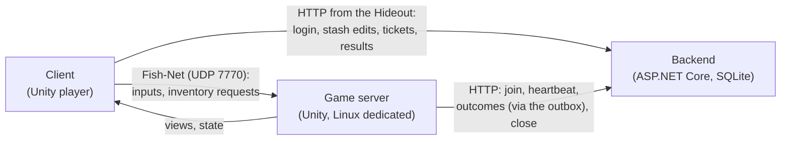
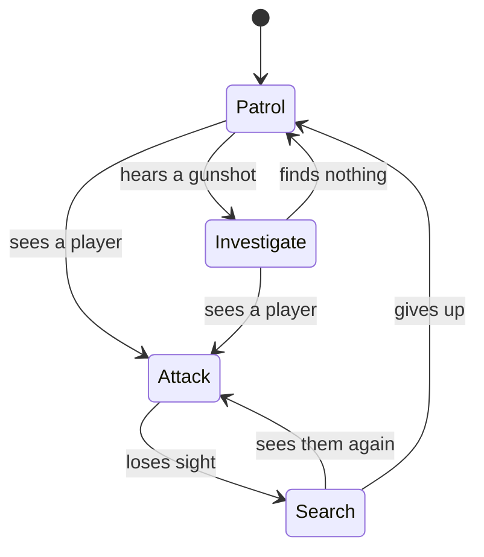

# Raid Zero: Unity Client & Game Server Plan

Will & John · first written Oct 26, 2026 · last updated Oct 29, 2026

## Status

| Area | State | Who |
| --- | --- | --- |
| Project skeleton, Fish-Net, both CI builds (Linux server image; Windows and macOS clients) | Done | Will |
| Predicted player controller | In progress | John |
| Raid inventory on the server, join and auth, raid lifecycle, extraction, outbox | Done | Will |
| Loot tables and crates | Done | Will |
| Inventory screen (raid), with the Hideout's data source, tooltips and rendered icons | Done | Will |
| Greybox map, NavMesh | Not started | John |
| Weapons, hit registration, damage, health and death | Not started | John |
| AI | Not started | John |
| Interaction, pickups, bodies and ground items in the world | Not started | To agree |
| Hideout screen: login, gear and stash, deploy, raid results | Done | Will |
| Scene flow: Boot, Hideout and raid scenes, joining | Not started | John |

Who owns what below is **proposed**: several of John's items moved to Will along the way, and the rest of the
split is for the two of you to agree. The README has the detail on everything that's built.

## Overview

The Unity side owns everything that happens inside a raid: how the game feels, what the server decides, and
what each client sees. Milestone 1 ends when one player can load in with gear, fight AI, loot, and either die
or extract, with the result showing up in their stash. It is the companion to the backend API and data model
doc; where the two meet (joining a raid, reporting outcomes, item IDs), that doc is the source of truth.

**Unity 6000.6.7f1 with URP, Fish-Net 4.7.4.**

**What this side owns in Milestone 1** (proposed split)

| Piece | Who |
| --- | --- |
| Player controller and camera, with client-side prediction | John |
| Weapons, hit registration, damage and death | John |
| AI enemies | John |
| The greybox map and its extraction points and crates | John |
| Raid timer, extraction rules, loot tables and rolling | Will (done) |
| Raid inventory on the server, and the inventory screen on the client | Will (done; the screen was John's, handed over) |
| Interaction, pickups, and bodies and ground items in the world | To agree |
| Hideout screen | Will (done) |
| The scene flow around a raid (Boot, Hideout and raid scenes, joining) | John |
| The dedicated server and client builds | Will (done) |

**Rules every system follows**

- **The server decides.** Damage, loot rolls, pickups, deaths and extraction run on the server. Clients send
  inputs and requests, never results.
- **Always networked.** Daily play uses Fish-Net's host mode or a dedicated server, so every feature runs
  through the network path from day one. There is no offline mode to keep in sync.
- **Predict only what the player controls.** Local movement and weapon feedback are predicted; everything else
  waits for the server.
- **Data lives in ScriptableObjects.** Weapons, items, AI types and loot tables are assets, not hardcoded
  numbers, so tuning never needs a code change.
- **Test on a bad connection.** Latency and packet-loss simulation stays on in the editor during normal
  development (see Network simulation).

## Architecture

The client talks to the game server over Fish-Net and to the backend only from the Hideout; the game server is
the only thing that reports raid results.



The client and server builds share the code in `shared/` for item data, fit checks and inventory rules, so the
client's previews and the server's decisions can't drift apart. The backend runs the same rules.

## Project setup

One Git repo shared with the backend, with LFS for binaries.

### Packages

| Package | Why | Installed |
| --- | --- | --- |
| Fish-Net | Networking, prediction, lag compensation. Default Tugboat transport | Yes (4.7.4, in `Assets/FishNet`) |
| Input System | Rebindable input; feeds the predicted controller cleanly | Yes |
| ProBuilder | Greybox the map inside Unity | Yes |
| Multiplayer Play Mode | Extra editor players for two-client checks | Yes |
| Newtonsoft JSON | Backend payloads and the item catalog | Yes |
| AI Navigation | NavMesh surfaces and agents for AI | Not yet |
| Cinemachine | Optional; first-person camera is simple enough without it | No |

### Code layout

The plan's `Game.Shared` / `Game.Server` / `Game.Client` / `Game.Gameplay` split became this:

```
shared/                       Plain C# packages, also built and tested as .NET projects
  Game.Shared/                RaidZero.Shared: catalog, inventory rules, raid protocol, inventory screen logic, loot tables
  Game.Raid/                  RaidZero.Raid: the server's raid inventory, lifecycle, extraction
  Game.BackendClient/         RaidZero.BackendClient: BackendClient (server), PlayerSession (Hideout), outbox
  catalog/item_catalog.json   Exported from the item assets
tests/                        xUnit tests for all of the above and the backend
unity/RaidZero/Assets/_Project/
  Scripts/Net/                Game.Net: Fish-Net glue (RaidServer, RaidAuthenticator, RaidInventoryClient, LootContainer, Hideout)
  Scripts/Shared/Items/       Game.Items: ItemDefinitionAsset, LootTableAsset, ItemLibrary, catalog export
  Scripts/UI/                 Game.UI: the inventory screen
  Scripts/Shared/             PlayerController (default assembly for now)
  Data/                       Items, Loot (ScriptableObjects), Resources
  Prefabs/, Scenes/, UI/
```

Server-only paths stay behind Fish-Net's server checks; the shared packages reference nothing from Unity, so
they're tested without the editor. Worth doing soon: give `PlayerController` and the gameplay code to come an
assembly of their own (`Game.Gameplay`), so they can reference `Game.Net` cleanly.

### Scenes

The plan, still the goal:

- **Boot:** the `NetworkManager` and long-lived services. Loads first, never unloads.
- **Hideout:** stash and equipment screens backed by the client API. No networking.
- **Raid\_Greybox01:** the map. Loaded by the server through Fish-Net's scene manager.

Today `SampleScene` is all three: the NetworkManager prefab, John's greybox geometry, a crate, and the
`InventoryScreen`. Add a `HideoutScreen` to it and it shows whenever you're not in a raid, so the scene works as
Hideout and raid at once until the scene flow exists; the F1 overlay's Deploy still works too. Not yet committed
to it: an `ExtractionZone` (the `ExtractionCube` is only a mesh) and `RaidSessionClient` on the NetworkManager.

### Builds

- **Client:** Windows 64-bit and macOS, as Development builds, from the `Game client` workflow on every push to
  `main` (artifacts kept 14 days).
- **Server:** Linux Dedicated Server build in CI (`Game server` workflow), smoke tested against a real backend
  and pushed as `ghcr.io/<owner>/<repo>/gameserver`. Unity is sometimes killed at startup on GitHub's runners,
  so the build retries once.
- **Daily play:** Multiplayer Play Mode in the editor (Server and Client buttons) against a local backend, or
  Deploy from the F1 overlay to a dedicated server. Playtests run the backend and game server on one PC over
  Tailscale (`deploy/LOCAL.md`).

### Version control

- Git with LFS for textures, models, audio and other binaries.
- Editor settings: Force Text serialization, Visible Meta Files. Configure Unity's Smart Merge (UnityYAMLMerge)
  as the merge tool.
- Only one person edits a given scene or prefab at a time. Put most content in prefabs so scene conflicts stay
  rare.
- A prefab with a missing script can't be saved, so commit scripts with the prefabs that use them. (The
  NetworkManager prefab has a stray `ServerCharacterController` component that needs removing.)

### Network simulation

Fish-Net's latency simulator on the NetworkManager's Transport Manager is set to 100 ms and 2% packet loss.
Tick its Enabled box and leave it on in the editor; turn it off only when profiling something unrelated. (It
was never saved ticked, so until someone does, it's off.) Builds turn it off whatever the box says
(`NetworkConditions`), so playtest clients and dedicated servers never add fake lag, unless started with
`--simulate-lag`. Each side delays what it sends, so between two editor instances a round trip is about
200 ms.

## Player controller (John, in progress)

Build a kinematic `CharacterController`-based controller driven by Fish-Net's prediction system: the owning client simulates its own inputs immediately, and the server's result corrects it when they disagree. Getting this right first matters more than anything else in the milestone, because every other system sits on top of it.

### How prediction fits together

- Gather input each tick into a small struct (move vector, look yaw and pitch, sprint, crouch, jump). This is Fish-Net's replicate data.
- A `[Replicate]` method applies one tick of input to the controller. It runs on the owner immediately and on the server when the input arrives.
- A `[Reconcile]` method takes the server's authoritative state (position, velocity, grounded, crouch state) and resets the client to it, after which Fish-Net replays the inputs the server hasn't processed yet.
- Keep the simulation inside the replicate method only. Anything that reads `Time.deltaTime` or `Update` instead of the tick delta will cause constant corrections.

### Scope for Milestone 1

- Walk, sprint, crouch, jump. No lean, slide or stamina yet.
- A fixed tick rate of 60 Hz (decided; it affects everything downstream, so keep it).
- First-person camera on the owner; other players see a simple capsule or placeholder model, interpolated smoothly.
- Look direction travels with each input tick, so the server knows exactly where the player was aiming.

### Known issues

- Mouse look reads only the latest frame's movement each tick, so look sensitivity drops as the frame rate rises
  above the tick rate (very low on a fast Mac). The fix is to add up the movement every frame and send the total
  each tick, without multiplying it by the tick time. Client and server change together.
- A sprint held while the inventory opens can stay on after it closes (buttons don't send a release when the
  input map switches).

### Done when

- With the latency simulator on, movement feels the same as with it off.
- Corrections only happen when something genuinely blocks you, and they're small.
- A second client sees your movement smoothly, without jitter.

## Weapons and hit registration (John, not started)

The shooter sees and hears their shot instantly, but only the server decides whether it hit. The server rewinds other players' hitboxes to where the shooter saw them, so a shot that looked right on screen counts.

### Fire flow

1. **Client (predicted):** plays muzzle flash, sound, recoil and decrements the displayed ammo. Sends a fire request with the tick it fired on and the exact aim ray.
2. **Server validates:** the weapon is equipped, fire rate allows it, the magazine in the server's raid inventory has a round, and the ray starts near the player's server position.
3. **Server rewinds:** uses Fish-Net's collider rollback to move hitboxes back to the shooter's tick, raycasts, then restores them. Cap rewind at about 200 ms so high-ping players can't shoot into the past indefinitely.
4. **Server applies:** consumes the round in the raid inventory, applies damage, and tells clients what happened (impact effects for everyone, a hit marker for the shooter).

Hit markers are server-confirmed in Milestone 1. They arrive one round trip late, which is honest and avoids showing hits that didn't count.

### Data

- `WeaponDefinition` (ScriptableObject, linked to its item `defId`): damage, rounds per minute, range falloff, spread, recoil pattern, compatible magazine defs.
- `Hitbox` components on a character's colliders with a zone (head, torso, limbs) and a damage multiplier.
- One health pool per character for now. Per-limb health is a later decision.

### Ammo and reloads

Ammo is real inventory: the round count lives in the ammo stack inside the magazine item inside the weapon. A reload swaps the weapon's magazine for a loaded one from the rig. That ties gunplay to the economy from day one, and the extraction report already carries the result. `RaidServer.Consume` uses up rounds (or a medkit) from the player's raid inventory on the server.

### AI shooting

AI fires through the same server damage path, without rewind since it runs on the server already. One damage path means one place to balance and debug.

### Done when

- At 100 ms simulated latency, shots that visibly land on a moving target register.
- Firing faster than the weapon allows, or with an empty magazine, does nothing on the server.
- Ammo count after a raid matches what was fired.

## AI enemies (John, not started)

AI runs only on the server, perceives the world the same way a player would, and acts through the same movement and damage code as players. Clients just see a networked character.

### Brain and body

Split each AI into a **brain** (decides) and a **body** (acts). The brain outputs intents such as move to a point, aim at a target, or fire. The body carries them out using the same weapon and damage paths as a player.

This split is what makes player-like bots possible later: the same brain can drive a body that loots, carries a real inventory, and extracts.

### Perception

- **Sight:** view distance, a view cone, and a line-of-sight raycast to a few points on the target (head, chest). Run it at 5 to 10 Hz, not every frame.
- **Hearing:** gunshots raise a noise event with a radius; AI inside it get a position to investigate. Footsteps can come later.
- **Reaction time:** a short delay between first seeing a player and first firing. Without it AI feels unfair.
- No cheating: AI never reads a player's position unless perception produced it.

### States



(Redrawn from the text when the original diagram was lost; John to confirm the states.)

From any state, health reaching zero ends the brain and turns the body into a loot container.

### Data

`AIProfile` ScriptableObject: health, weapon definition, accuracy curve over distance, reaction time, view distance and angle, and the loot table that fills its body when it dies.

### Movement

Server-side `NavMeshAgent` on a baked NavMesh. Clients receive position through a network transform and interpolate. The body's dead state turns it into a loot container, using the same container code as crates.

### Done when

- AI notices you by sight and by gunfire, fights, loses you, searches, and gives up.
- 8 to 10 AI on the map don't noticeably cost server frame time.
- Killing one leaves a lootable body.

## Raid flow and level

One small greybox map, one server-run raid timer, and two ways out: extract or die. One raid per server
process, then exit; a fresh process per raid means no state leaks between raids, and it's how container
hosting runs it (Docker restarts the server for the next raid).

### Greybox map (John, not started)

- Roughly 200 by 200 m, built in ProBuilder.
- 3 or 4 distinct points of interest, so routes and risk differ.
- 8 to 12 loot containers (`LootContainer`), weighted toward the riskier areas.
- 2 extraction points (`ExtractionZone`), far from the main spawn.
- AI spawn zones and 2 or 3 player spawn points.
- Bake the NavMesh from the greybox; rebake when geometry changes.

### Raid states on the server (done)

`RaidLifecycle` in `Game.Raid`, driven by `RaidServer`:

| State | What happens | Leaves when |
| --- | --- | --- |
| Waiting | Scene loaded, loot rolled, AI spawned; players join with tickets | The first player joins (that starts the clock) |
| In progress | The clock runs (25 minutes; `--raid-minutes` on a dedicated server); heartbeats every 10 s | Time runs out, everyone who joined has extracted or died, or nobody inside has been connected for 3 minutes |
| Ending | Anyone still inside is missing in action (dies); reports flush from the outbox | All reports acknowledged, or the close timeout |
| Closed | Close report sent, process exits | n/a |

A disconnected player's gear stays in the raid, and Deploy with the same ticket brings them back while it runs.

### Extraction (done)

A player extracts by staying inside an extraction zone for 8 seconds. The server tracks the countdown; leaving
the zone or taking damage (`RaidServer.InterruptExtraction`, for gameplay to call) resets it. On completion the
server freezes that player's raid inventory, writes the outcome report to the outbox, tells the client how they
left, and disconnects them a moment later. The Hideout then fetches the raid result.

### Death (server side done; world side to agree)

Gameplay calls `RaidServer.PlayerDied`. The player's raid inventory becomes a body container holding their
gear, the server sends a `died` outcome, and the client is told how they left. The body must be its own object
in the world, since Fish-Net despawns whatever the dead player's connection owns; spawning it, and showing
ground piles from drops, is the world side that's still to do.

### Loot (done)

- `LootTableAsset` (Create > Raid Zero > Loot Table): a number of picks, each a weighted choice among items or
  other tables, or nothing. An item entry has a quantity range for stacks, a condition range, and a chance of
  coming loaded (a weapon with a magazine, a magazine with rounds) with a fill range.
- A container type's item asset names its default table; a crate can name its own. A crate's fixed Contents
  list overrides both, for testing.
- Containers roll on the server at raid start from a per-raid seed the server logs; `--loot-seed` (or Loot
  Seed on `RaidServer`) repeats a raid's loot exactly.
- Every spawned item gets a UUIDv7 at spawn time, so its ID is stable from container to stash.
- The table inspector lists problems and simulates a thousand rolls.

### Done when

- [x] A full raid runs start to finish in host mode and as a dedicated server.
- [x] Extract lands the right result in the stash. Death does too on the server side; it needs health and
  damage to happen in play.
- [x] The timer running out kills anyone still inside.

## Inventory on the Unity side

Inventory is where the two halves of the project meet, so the rules live in one shared C# library used by the
client, the game server and the backend. The client only previews; the server and backend decide.

### Who builds what

| Piece | Who | State |
| --- | --- | --- |
| Shared inventory model (`Game.Shared`) | Will | Done: item tree, grid fit checks with named grids, slot rules, catalog loading |
| Item catalog export (editor script) | Will | Done: exports on save |
| `RaidInventoryService`, `RaidInventoryHost` and `BackendClient` (server) | Will | Done |
| The network seam (`RaidProtocol` over Fish-Net broadcasts, `RaidInventoryClient`) | Will | Done; replaced the planned `PlayerInventoryNetwork` RPCs |
| Inventory screen logic (`Game.Shared/InventoryUi`) | Will | Done: drop rules, quick move, splitting, opening containers, tooltips |
| Inventory screen in a raid (`Game.UI`) | Will (handed over from John) | Done |
| Hideout inventory source (`HideoutInventorySource`) | Will | Done |
| Hideout screens and scene flow | To agree | Not started |
| World containers, pickups, bodies, interaction | To agree | Crates done; the rest not started |
| Item `ScriptableObject` authoring | Both | Ongoing: sizes, stack limits, slots, models; icons render from models (Render Icons) |

### In a raid

- The screen sends a request (move, split, merge, pick up, drop, open, close) through `RaidInventoryClient` and
  dims the items involved until the answer arrives.
- The server checks reach and rate limits, applies it with `RaidInventoryService`, and sends the owner fresh
  views of the containers that changed.
- While dragging, the screen checks the drop with exactly the server's rules (`InventoryModel.Plan`), so it
  shows green or red and never sends what it knows will be refused. It never applies a change until the server
  confirms it.
- Controls: Tab opens the screen; drag to move; R rotates while dragging; Shift+drag splits a stack;
  Ctrl+click (Cmd+click) quick-moves; double-click opens a container inside another; dragging out of the
  window drops; resting the pointer on an item shows its tooltip. F opens the nearest crate until interaction
  exists.
- At 100 ms latency inventory still feels fine without prediction; revisit only if playtests say otherwise.

### In the Hideout

The Hideout calls the client API directly over HTTP through `PlayerSession`: fetch the profile, send inventory
ops with the profile version, refetch on a version conflict. `HideoutInventorySource` puts that behind the same
`IInventorySource` the raid uses, so the same screen works in both places; only the source behind it differs.

`HideoutScreen` (`Game.UI`) is that screen: log in (dev login by name), sort gear and stash, Deploy, and a result
panel after each raid (what came home, what was lost). It shares the window, dragging and tooltips with the raid's
`InventoryScreen` through `InventoryView`. It shows itself whenever the scene's NetworkManager has no client or
server running; scene flow can turn that off and call `Show`/`Hide`, and can take over deploying by listening to
`DeployRequested` (map ID), in which case the screen only asks.

### The contract

These must match exactly across Unity and the backend. Change them in one pull request that touches both sides.

- **Item tree shape:** `id`, `def_id`, `slot`, optional `x`, `y`, `rotated`, `quantity`, `durability`,
  `children`. The same shape as the backend's join and outcome payloads.
- **IDs:** UUIDv7 strings. The server mints them for raid loot; the backend mints them for everything else.
  (Crates and other raid-only roots get name-derived IDs, the same on every machine, and never leave the raid.)
- **Slot names:** one shared constants file (`SlotNames`: `primary`, `secondary`, `armor`, `rig`, `backpack`,
  `magazine`, `rounds`). An item in a grid has the grid's name as its slot; a container's only grid is `grid`.
- **`defId` values:** stable forever once an item has existed in anyone's stash. Rename the display name, never
  the ID.

## Build order

Two tracks ran in parallel until step 8, when they joined. Each step ends with something you can check.

1. **Skeleton (both). Done,** except the Boot scene and saving the latency simulator switched on. Repo, packages, assembly definitions, host mode, Linux
   server build in CI (and now client builds).
   - Check: a host and a second client connect in an empty scene, with the latency simulator on.
2. **Predicted movement (John). In progress.**
   - Check: the controller's done list above.
3. **Greybox map v0 and NavMesh (John). Not started.**
   - Check: you can walk every route; AI agents can path between points of interest.
4. **Hitscan weapon (John). Not started.** First against a static dummy, then against the second client.
   - Check: the weapons done list above.
5. **AI v1 (John). Not started.** Patrol and attack first, then investigate and search.
   - Check: the AI done list above.
6. **Shared inventory model and catalog export (Will). Done.**
   - Check: unit tests cover fit, stacking, nesting and slot rules; the catalog exports from real ScriptableObjects.
7. **Raid inventory and loot (both). Done,** except reloading from inventory, which comes with weapons
   (`RaidServer.Consume` is ready for it).
   - Check: loot a crate, equip a magazine, reload from it, and drop items, all at simulated latency.
8. **Join from the backend (pair). Done.** Fish-Net authenticator, `/join`, spawn from the returned loadout.
   - Check: gear set up in the stash appears on the character in the raid.
9. **Extract, die, timer and outbox (pair). Done** on the server side; death in play waits on step 4.
   - Check: the raid flow done list above, including killing the server mid-raid and confirming the refund.
10. **Hideout screen (Will). Done;** scene flow around it (John) not started. Stash and equipment UI over the client API.
    - Check: rearrange gear, start a raid, come back, and see the result.
11. **End-to-end playtest (both). Partly done:** Tailscale playtests against a dedicated server on a home PC; not
    yet on a VPS, or with AI and weapons.
    - Check: Milestone 1 is done.

## Testing and open questions

Automate what can be expressed as rules, and playtest what can only be felt.

### Testing

- **Unit tests** (xUnit, under `tests/`) for everything in `shared/`: inventory fit and stacking, the raid
  protocol, the inventory screen's drop rules, loot table rolls with a fixed seed, the raid lifecycle. Damage
  math joins them when it exists.
- **Headless tests in CI:** the server build starts against a real backend and must report ready and listen on
  UDP 7770. Then the same image, as a scripted player (`--ci-client`), plays two short raids: one extracting at a
  zone the server puts at its spawn (`--test-extract-at-spawn`), one missing in action when the clock runs out. It
  checks the backend's result and its gear each time. It joins and stands still, so it needs no map features.
- **Network conditions:** test at 0 ms, 100 ms with 2% loss, and 200 ms with 5% loss before calling any
  gameplay feature done.
- **Two-client checks:** use Multiplayer Play Mode or two builds for anything another player can see.
- **Checklists:** `unity/TESTING-INSTRUCTIONS.md` has what to check for each feature.
- **Weekly playtest:** play several full raids together and write down what felt wrong, before fixing anything.

### Open questions

- [ ] Hit markers: keep server-confirmed, or predict them once playtests show the delay matters?
- [ ] Third-person body for remote players: buy an animated asset pack now, or stay on capsules until the loop
  is fun?
- [ ] Who takes interaction, pickups and bodies in the world? (The Hideout screen is Will's, done; scene flow is John's.)
- [x] Tick rate: 60 Hz.
- [x] Grid inventory or slot-based: grids (Tarkov-style), plus named slots and pockets.
- [x] Disconnects: the gear stays in the raid and the player can rejoin with the same ticket until it ends;
  still out at the end means missing in action.
